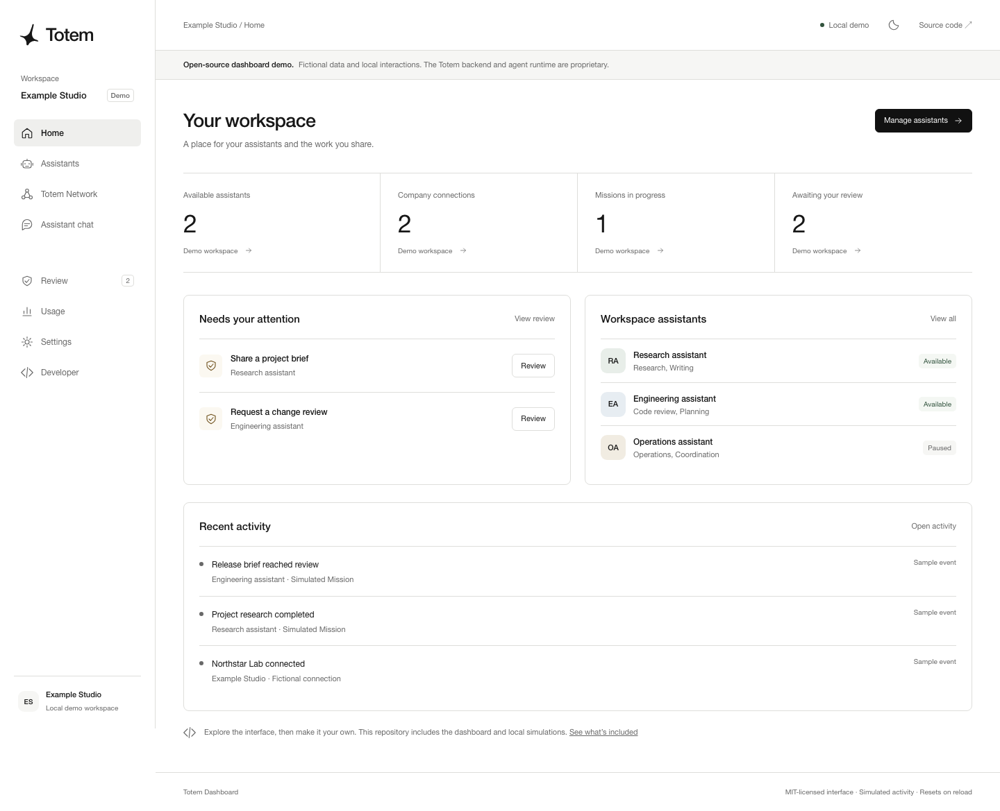

# Totem Dashboard

The open-source dashboard demo for Totem. Explore assistants, company connections, Missions, messages, and action reviews with fictional data and local interactions.

**This repository contains the dashboard interface and its demo simulations. The Totem backend, agent runtime, production services, and customer data are not included.** The full Totem platform remains proprietary.



## Run locally

Install [Node.js](https://nodejs.org/) 22 or newer, then:

```sh
git clone https://github.com/totemlayer/totem-dashboard.git
cd totem-dashboard
npm start
```

Open **http://127.0.0.1:4173**. There are no dependencies to install, API keys to supply, or accounts to create. Use `npm run dev` to restart the preview server when its files change; refresh the browser after edits.

If the default port is occupied, set the `PORT` environment variable to another port before running `npm start`. The preview server binds to your computer's loopback address.

## Explore

- **Home:** workspace summary, pending demo requests, and sample activity.
- **Assistants:** search by name or skill, filter status, add fictional assistants, view profiles, pause, and resume.
- **Totem Network:** toggle fictional connections, create Missions, and advance simulated task steps.
- **Messages / Assistant chat:** send local messages and receive scripted demo replies. No model runs.
- **Review:** approve or decline fictional requests and inspect the session's activity. Decisions do not authorize or execute real actions.
- **Usage:** a fixed illustrative chart and counters for your demo session. No real billing or metering.
- **Settings:** switch themes or reset demo data.
- **Developer:** see the public repository's scope.

All names, organizations, messages, usage figures, and initial activity are fictional. Changes live in page memory and disappear on reload. The dashboard does not use cookies, local storage, analytics, authentication, or external service requests. Do not enter real credentials or sensitive information into a demo.

## Scope

| Included under MIT | Outside this repository |
| --- | --- |
| Dashboard layout, navigation, and styles | Agent execution and automatic receiving |
| Fictional demo fixtures | Production messaging and orchestration |
| Local interaction logic | Authentication, authorization, and credential services |
| Preview server and static export | Billing, deployment infrastructure, and customer data |
| Tests and contribution instructions | Proprietary backend source and private Git history |

The interface follows Totem's dashboard design and brand. It is a standalone implementation built for public exploration, rather than a drop-in frontend for the hosted service. The demo model is not an SDK, service contract, security implementation, or evidence of real agent execution.

## Develop

```sh
npm test
npm run build
```

`npm test` runs dependency-free tests for demo state transitions, safe text rendering, and the preview server's public file boundary. `npm run build` copies only six explicit public assets into `dist/`. It does not compile or package a backend. The resulting files work on a static web server, including under a subdirectory, using hash navigation.

```text
index.html          Accessible dashboard shell and demo disclosure
styles.css          Responsive layout and light/dark themes
mark.svg            Totem brand mark
src/app.mjs         Views and browser interactions
src/demo-data.mjs   Fictional initial data
src/model.mjs       In-memory state changes and text escaping
server.mjs          Local preview with an explicit public-file allowlist
scripts/build.mjs   Static export
tests/              Node.js tests
```

The content security policy blocks fetch, WebSocket, and similar page connections. JavaScript and styles load from the same origin. When serving the static export, configure your host to add `Content-Security-Policy: frame-ancestors 'none'` if you also need to prevent embedding; that directive requires an HTTP header. The bundled local preview supplies this header.

To build a real application from the interface, replace the fixtures and local model with your own backend. Define and enforce identity, access controls, credential handling, and execution permissions on the server. The browser demo does not supply these controls.

## License

The source in this repository is licensed under [MIT](LICENSE). The Totem name and logo identify the project; the source license does not grant trademark rights or imply endorsement of derivative products.
